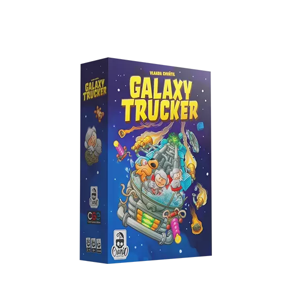

# Galaxy Truckers

<p style="text-align: center;">

</p>

<div style="text-align: center;">
    <a href="https://github.com/Garolini/IS25-LL14/releases/latest">
        
    </a>
    <a href="https://github.com/Garolini/IS25-LL14/releases/latest">
        
    </a>
   <a href="https://github.com/Garolini/IS25-LL14/releases/latest">
        
    </a>
</div>

## Project Overview

This project is a Java-based implementation of the table game "**Galaxy Truckers**", developed as the Final Project for
the 2024/2025 Software Engineering course at Politecnico di Milano. The team comprises Garolini Michele, Jafari Michael
and Migliaccio Cesario.

<!--Check out our project presentation [here.](https://garolini.github.io/)-->

## Status of the work

| Functionality     | Status             | 
|-------------------|--------------------|
| Basic rules       | :white_check_mark: |
| Complete rules    | :white_check_mark: |
| Socket connection | :white_check_mark: |
| CLI               | :x:                |
| GUI               | :white_check_mark: |
| Multiple games    | :x:                |
| Resilience        | :construction:     |
| Chat              | :white_check_mark: |

(*) *For testing purposes.*

**Legend**

| Symbol                  | Functionality status          |
|-------------------------|-------------------------------|
| :white_check_mark:      | Completed                     |
| :ballot_box_with_check: | Planned, not started yet      |
| :construction:          | Work in progress              |
| :x:                     | Not planned to be implemented |

### Game Description

"Galaxy Trucker" is a fast-paced board game by Vlaada Chvátil where players build and pilot spacecraft to deliver goods
through space hazards. The game features a real-time shipbuilding phase and exciting space travel challenges.
Learn more about the game [here](https://www.craniocreations.it/prodotto/galaxy-trucker).
Rules of the game [here](https://www.craniocreations.it/storage/media/product_downloads/179/2052/Galaxy-Trucker_ITA_Rules_compressed.pdf).

## How to Compile with Maven

To compile the project using Maven, follow these steps:

1. Ensure you have Maven installed. You can download it
   from [Maven's official website](https://maven.apache.org/download.cgi).
2. Navigate to the root directory of the project where the `pom.xml` file is located.
3. Run the following command to compile the project and package it into a JAR file:

```bash
    mvn clean package
   ```

This command will generate a main jar inside the `target` folder

## How to Run the Program

You can run the program using the JAR file found in the [releases](https://github.com/Garolini/IS25-LL14/releases) section of the repository.

### Running the Server

To run the server, use the following command:

```bash
    java -jar galaxy_trucker-x.x.jar server [options]
```

### Running the Client

To run the client, use the following command:

```bash
    java -jar galaxy_trucker-x.x.jar client [options]
```

## Server CLI Arguments

| Argument        | Description                              | Accepted Values          | Default Value |
|-----------------|------------------------------------------|--------------------------|---------------|
| `--port`, `-p`  | TCP port the server listens on.          | Any valid port (0–65535) | 8080          |
| `--debug`, `-d` | Enables debug mode with verbose logging. | (flag only)              | Off           |

## Client CLI Arguments

| Argument        | Description                              | Accepted Values | Default Value |
|-----------------|------------------------------------------|-----------------|---------------|
| `--lang`, `-l`  | Sets the client UI language.             | `en`, `it`      | `en`          |
| `--debug`, `-d` | Enables debug mode with verbose logging. | (flag only)     | Off           |


## Legal 🇬🇧

Galaxy Truckers is a board game developed and published by Cranio Creations S.R.L.
The graphic content of this project attributable to the tabletop publishing product is used with prior
approval of Cranio Creations S.R.L. for educational purposes only. It is prohibited to distribute, copy or reproduce
of the contents and images in any form outside the project, as well as the redistribution and publication
of the contents and images for purposes other than the aforementioned. Commercial use of said content is also prohibited.

## Legal 🇮🇹

Galaxy Trucker è un gioco da tavolo sviluppato ed edito da Cranio Creations S.R.L.
I contenuti grafici di questo progetto riconducibili al prodotto editoriale da tavolo sono utilizzati previa
approvazione di Cranio Creations S.R.L. a solo scopo didattico. È vietata la distribuzione, la copia o la riproduzione
dei contenuti e immagini in qualsiasi forma al di fuori del progetto, così come la redistribuzione e la pubblicazione
dei contenuti e immagini a fini diversi da quello sopracitato. È inoltre vietato l'utilizzo commerciale di suddetti
contenuti.