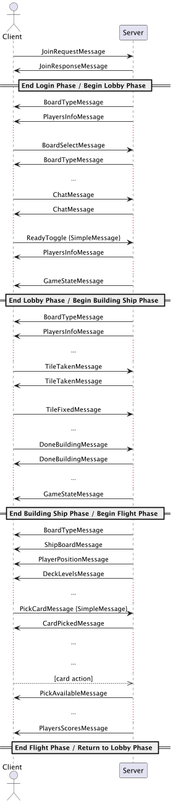

# Protocollo di Comunicazione – Documentazione Tecnica

1. Introduzione
2. Architettura del sistema
3. Descrizione del protocollo
   1. Tipo di protocollo
   2. Struttura dei messaggi
4. Estendibilità protocollo
5. Esempi sessione completa
6. Classi java utilizzate per i messaggi


## 📖 1. Introduzione
Il presente documento descrive il protocollo di comunicazione implementato per il progetto Galaxy Trucker, una versione digitale del noto gioco da tavolo, sviluppata in linguaggio Java.

Galaxy Trucker è un gioco multigiocatore in cui i partecipanti competono costruendo e guidando le proprie astronavi attraverso viaggi spaziali ricchi di eventi. Per rendere possibile l’interazione tra i diversi giocatori, è stato realizzato un sistema client-server basato su protocollo TCP, che consente uno scambio affidabile di messaggi tra le componenti del gioco.

Il server centralizza la logica del gioco, ospita il modello (game model), il controller e gestisce il flusso generale della partita. I client rappresentano le interfacce utente attraverso cui i giocatori interagiscono con il gioco e comunicano con il server.

L’obiettivo di questo documento è fornire una descrizione dettagliata della struttura della comunicazione tra client e server, con particolare attenzione:
- al formato e ai contenuti dei messaggi scambiati,
- 	alla sequenza delle interazioni durante le varie fasi di gioco,
- 	alla gestione degli errori,
- 	all’estendibilità del protocollo.
---

## 🏗️ 2. Architettura del Sistema

Il sistema segue un'architettura di tipo **client-server**, in cui il **server** agisce come coordinatore centrale dell'intera partita e gestisce la logica del gioco, mentre i **client** fungono da interfaccia utente per i giocatori.

I **client** si connettono al server tramite connessione **TCP** e non comunicano tra loro direttamente. Ogni client interagisce esclusivamente con il server, che si occupa di ricevere le azioni inviate, elaborarle e restituire gli aggiornamenti relativi allo stato del gioco.

### 🔧 Componenti principali

#### Server
- **GameModel**: contiene lo stato del gioco e tutti gli oggetti necessari per rappresentare una partita.
- **Controller**: gestisce la logica delle azioni inviate dai client e aggiorna il modello.
- **EventDispatcher**: sistema di notifica che si occupa di propagare gli eventi di gioco verso le interfacce client.
- **VirtualView**: una per ogni client connesso, funge da interfaccia tra il modello del gioco e il client remoto.

#### Client
- **Interfaccia Grafica (JavaFX)**: consente all’utente di interagire con il gioco in modo intuitivo.
- **VirtualServer**: gestisce la connessione al server e l'invio/ricezione dei messaggi.
- **Controller**: coordina la logica tra l’interfaccia grafica (JavaFX) e il VirtualServer. Gestisce gli input dell’utente, aggiorna la vista in base agli eventi ricevuti dal server, e traduce le azioni dell’utente in messaggi da inviare al server. Funziona da mediatore tra modello e vista, garantendo una separazione chiara delle responsabilità. 
### 🧪 Tecnologie utilizzate

- **Linguaggio**: Java
- **Protocollo di comunicazione**: TCP
- **Formato dei messaggi**: oggetti Java serializzati
- **Multi-threading**: ogni client è gestito da un thread dedicato lato server
- **Librerie GUI**: JavaFX---

## 🧬 3. Descrizione del Protocollo

### 🔌 3.1 Tipo di Protocollo
Il sistema utilizza un protocollo di comunicazione basato su TCP, realizzato tramite i Java Sockets. La scelta di questo protocollo garantisce una trasmissione dei dati affidabile e ordinata, essenziale per la corretta sincronizzazione tra i client e il server durante le partite.

La comunicazione è di tipo asincrono lato client: ogni client può inviare più messaggi consecutivi al server senza attendere una risposta immediata, grazie a un buffer di input lato server che gestisce i messaggi in arrivo. Questo approccio consente una maggiore flessibilità e reattività nell’interazione con l’interfaccia utente.

Il server, invece, non invia messaggi spontanei ai client, ad eccezione di un meccanismo di heartbeat progettato per monitorare la connessione attiva con ciascun client e rilevare eventuali disconnessioni.

La connessione TCP viene mantenuta aperta e persistente per l’intera durata della sessione di gioco, dalla fase di login fino alla conclusione della partita. In caso di disconnessione, il sistema supporta la riconnessione del client.

Il protocollo si basa sullo scambio di oggetti Java serializzati, che rappresentano i messaggi trasmessi tra le due parti.

### 🧾 3.2 Struttura dei Messaggi
Tutti i messaggi scambiati tra client e server implementano l’interfaccia comune GameMessage, la quale definisce un metodo getType() che identifica il tipo di messaggio. Questa struttura favorisce l’estensibilità e una gestione più semplice dei messaggi lato server e client.

I messaggi sono rappresentati da oggetti Java serializzati in formato JSON, grazie all’uso della libreria Jackson. Questo consente di rendere il protocollo leggibile, interoperabile e facilmente testabile.

Di seguito sono riportati alcuni dei messaggi principali utilizzati nel protocollo, suddivisi per fase del gioco:


#### JoinRequestMessage
- **Direzione**: Client --> Server
- **Descrizione**: Invia informazioni relative a un giocatore che prova ad entrare nella lobby. (es. nome, colore, avatar, stato di prontezza, ruolo di admin).
- **Campi**:
  - username: String – Nome del giocatore
  - profilePicIds: int[] – Identificatori dell’avatar del profilo (es. più immagini per rappresentare un profilo dinamico)
  - color: String – Colore scelto dal giocatore 
  - admin: boolean – true se il giocatore è l’host della partita
  - ready: boolean – true se il giocatore ha segnato lo stato come “pronto”
  - Tipo: join_request
```json
{
   "type": "join_request",
   "username": "Marianna",
   "profilePicIds": [1, 4],
   "color": "RED",
   "admin": true,
   "ready": false
}
```

#### JoinResponseMessage

- **Direzione**: Server -> Client
- **Scopo**:  Informa il client sull’esito della richiesta di accesso alla lobby.
- **Campi**:
  - joinStatus: JoinStatus (enum: SUCCESS, LOBBY_FULL, NAME_TAKEN, GAME_STARTED)
- **Tipo**: join_response

```json
{
   "type": "join_response",
   "joinStatus": "SUCCESS"
}
 ```

####  GameStateMessage

- **Direzione**: Server -> Client
- **Scopo**: Invia al client lo stato attuale del gioco.
- **Campi**:
   - gameState: GameModel.GameState – oggetto serializzato dello stato di gioco
- **Tipo**: game_state

```json
{
   "gameState":"BUILDING_SHIPS",
   "type":"game_state"
}
```

#### SimplePlayerMessage

- **Direzione**: Variabile (Server -> Client / Clinet -> Server)
- **Scopo**: Messaggio generico utilizzato per notificare eventi che richiedono solamente l’identificazione del giocatore. Il campo type viene impostato dinamicamente in base al contesto.
- **Campi**:
   - type: String – Tipo di messaggio (es. "ready_toggle", "ping", ecc.)
   - playerName: String – Nome del giocatore coinvolto
- **Tipo**: dinamico (valore impostato nel costruttore)

```json
{
   "type": "ready_toggle",
   "playerName": "Marianna"
}
```
## 🔧 5. Estendibilità del Protocollo
Questa sezione descrive come il protocollo di comunicazione è progettato per essere esteso, come gestisce il versionamento e cosa accade nel caso di messaggi non riconosciuti.

#### Aggiunta di nuovi messaggi

Il protocollo è pensato per essere facilmente estendibile. Tutti i messaggi implementano l’interfaccia comune GameMessage, che definisce il metodo getType(). Questo consente di identificare dinamicamente il tipo di messaggio durante la deserializzazione e il dispatching.

Per aggiungere un nuovo messaggio è sufficiente:
1. Creare una nuova classe che implementa GameMessage.
2. Implementare il metodo getType() con un identificatore univoco per il messaggio.
3. Aggiornare, se necessario, il dispatcher/event handler per gestire il nuovo tipo.
   
Grazie all’uso di Jackson per la serializzazione/deserializzazione, il sistema è in grado di costruire dinamicamente istanze dei nuovi messaggi senza modificare il core della logica di parsing.

#### Comportamento con messaggi sconosciuti

La libreria Jackson, utilizzata per la deserializzazione, è configurata per ignorare i campi sconosciuti tramite l’annotazione @JsonIgnoreProperties(ignoreUnknown = true). Questo rende il protocollo tollerante all’aggiunta di nuovi campi nei messaggi.

Nel caso in cui il tipo di messaggio (getType()) non sia gestito dal dispatcher, il messaggio viene ignorato o scartato senza generare errori, preservando la stabilità del sistema.

---

## 🧪 6. Esempi di Sessione Completa
Esempio pratico di scambio messaggi:



## 💾 7. Classi Java Utilizzate per i Messaggi

#### sendMessage

Di seguito un esempio concreto di metodo per serializzare e inviare un messaggio tramite protocollo TCP in formato JSON.


```java
    public  void sendMessage(GameMessage message) {

        ObjectMapper mapper = new ObjectMapper();
        String json;
        try {
            json = mapper.writeValueAsString(message);
        } catch (JsonProcessingException e) {
            throw new RuntimeException(e);
        }
        this.out.println(json);
    }
```

Serializza un oggetto che implementa GameMessage in JSON e lo invia attraverso lo stream di output (PrintWriter out).

- Estendibilità: Il metodo funziona per qualsiasi classe che implementa GameMessage.
- Compatibilità: Utilizza JSON, un formato standard, leggibile e facilmente gestibile.
- Robustezza: Gli errori di serializzazione sono gestiti e sollevati in modo esplicito.

 **Dipendenze**

```xml
    <!-- Jackson -->
<dependencies>
    <dependency>
      <groupId>com.fasterxml.jackson.core</groupId>
      <artifactId>jackson-databind</artifactId>
      <version>2.17.0</version>
    </dependency>
    <dependency>
      <groupId>com.fasterxml.jackson.dataformat</groupId>
      <artifactId>jackson-dataformat-xml</artifactId>
      <version>2.18.2</version>
    </dependency>
</dependencies>
```

#### VirtualView: run()

Il metodo run() in VirtualView rappresenta il ciclo principale di ascolto lato server per un singolo client. È eseguito da un thread separato per ogni client connesso.

```java
    public void run() {
        startPingLoop();

        try {
            while (true) {
                String msg = in.readLine();
                Logger.logDebug("RECEIVED: " + msg);
                if (msg == null) {
                    Logger.logInfo("Client disconnected.");
                    break;
                }
                this.controller.processCommand(this, msg);
            }

        } catch (SocketException e) {
            Logger.logWarning("Client disconnected: " + e.getMessage());
        } catch (IOException e) {
            if ("Stream closed".equals(e.getMessage())) {
                Logger.logInfo("Stream closed locally.");
            } else {
                Logger.logError("IOException: " + e.getMessage());
            }
        } finally {
            close();
        }
    }

```

##### Funzionamento

- startPingLoop(): Avvia un meccanismo periodico per verificare la connessione (es. heartbeat).
- in.readLine(): Attende messaggi dal client (JSON come stringa). Il metodo è bloccante.
- processCommand(...): Inoltra il messaggio al controller per l’elaborazione.
- Gestione delle eccezioni: Intercetta errori legati alla connessione per chiusure controllate e inattese.


##### Ciclo di vita

1.	Si avvia un thread per il client.
2.	Entra in un ciclo infinito in ascolto sul canale in.
3.	Termina in caso di:

      - disconnessione del client (msg == null)
      - eccezioni sul socket
      - chiusura dello stream

